# PalPalPal
A Perfect Palette-n-Pixel Editor. Now supporting 3D features.

# More About

PalPalPal supports:
- Palette editing for 2D and 3D Images as well as palette files themselves.
- 2D and 3D views, editing, and exporting
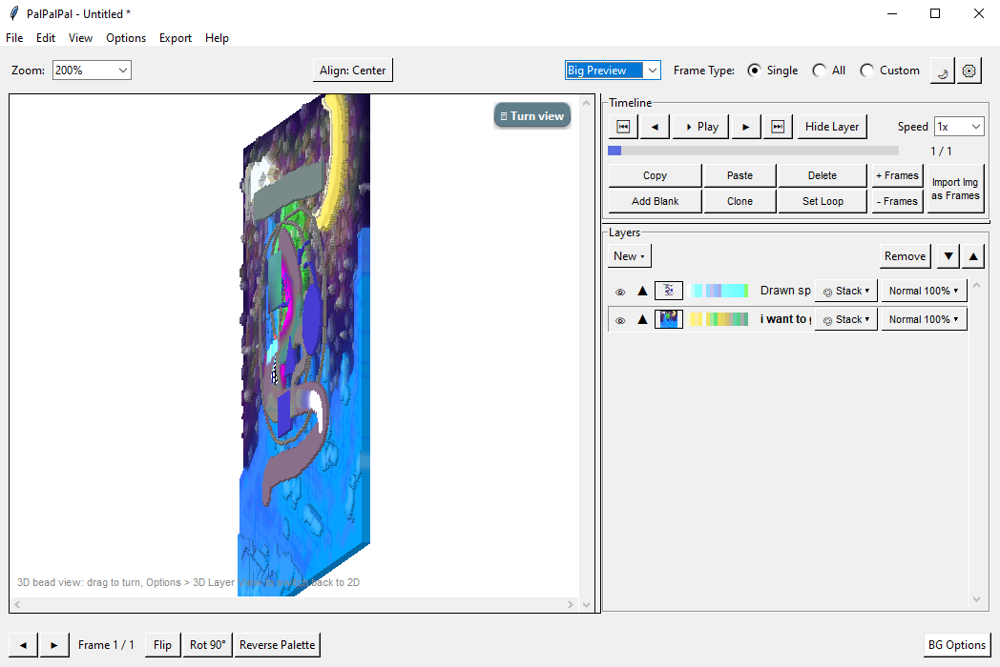
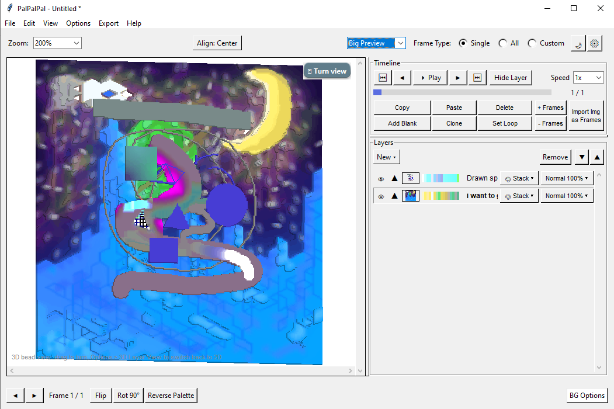
- 3D Rotation, mirroring, and Heightmap Control
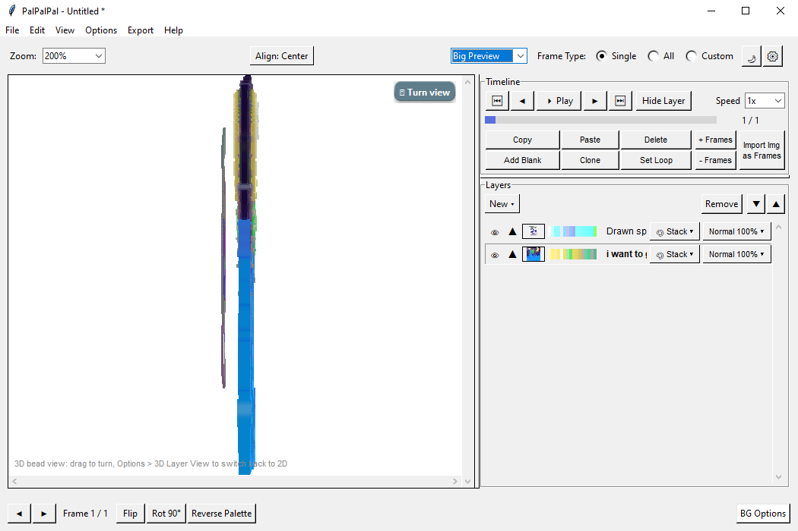
- Palette indexing up to 256 indexes, swapping, and exporting
- Heightmap display, editing, and exporting
- 3 Main Display Modes ->
	- Big Preview:
		- Timeline, Frame Controls, and Palette/Image layer preview along with actual Image preview

	- Small Preview:
		- Timeline, Palette/Image layer preview, smaller Image Preview window than Big, Saved
			colors boxes, index displays, HSV Adjustments, image and frame controls
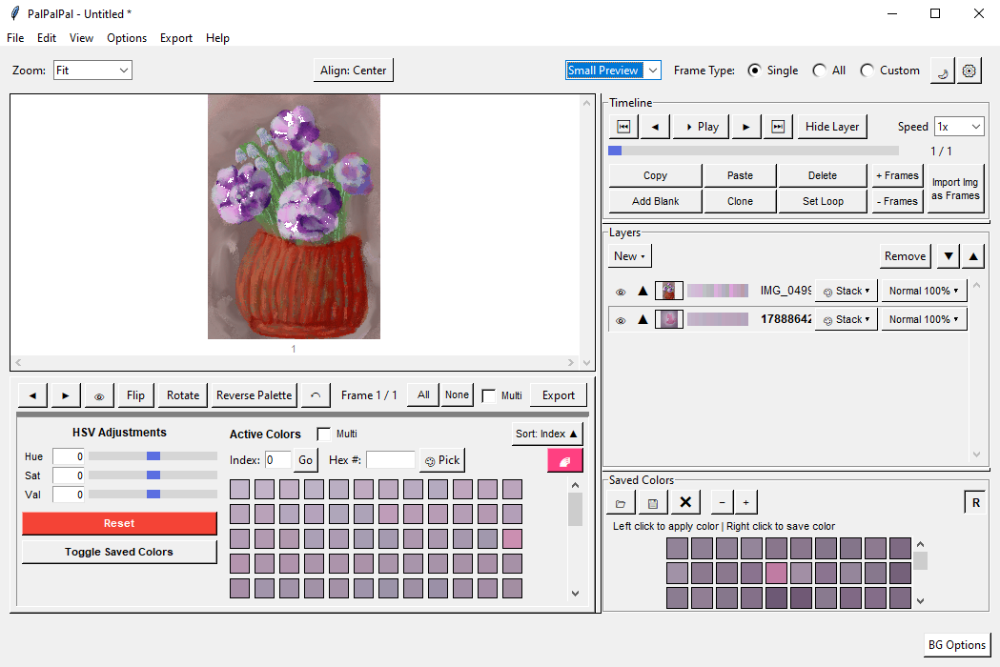
	- No Preview:
		- Basically everything in Small Preview but with the Indexes and HSV sliders bigger with
			no image preview or changes. However, Timeline and Layers are still visible, as
			one may want to change them.
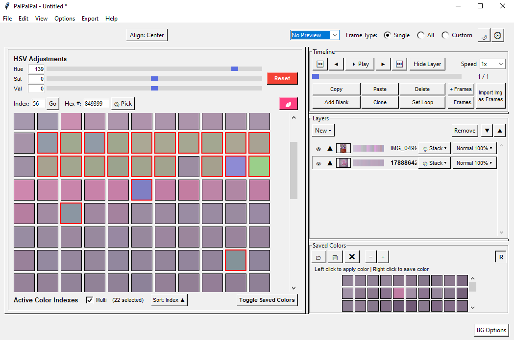
- A mini Editor with 3 UI's:
	- Simple:
		- Grid showing all indexes, Saved Colors, HSV Adjustment sliders, Multi-select, Gradient
			button, Palette Export and selection.
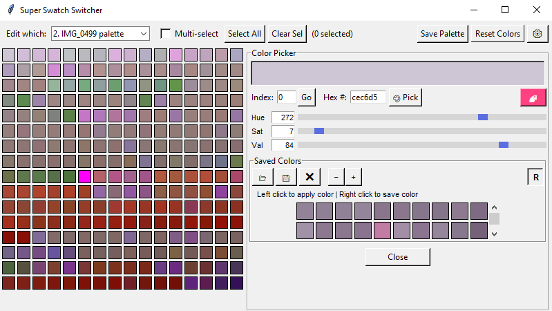
	- Advanced:
		- Image Preview, Filtered indexes, Colorpicker, Gradient button, Click-to-select-index, 
			Index sorting, multi-select, color sliders (Hue/Saturation/Value), palette export 
			and selection, frame preview, saved colors, and zoom
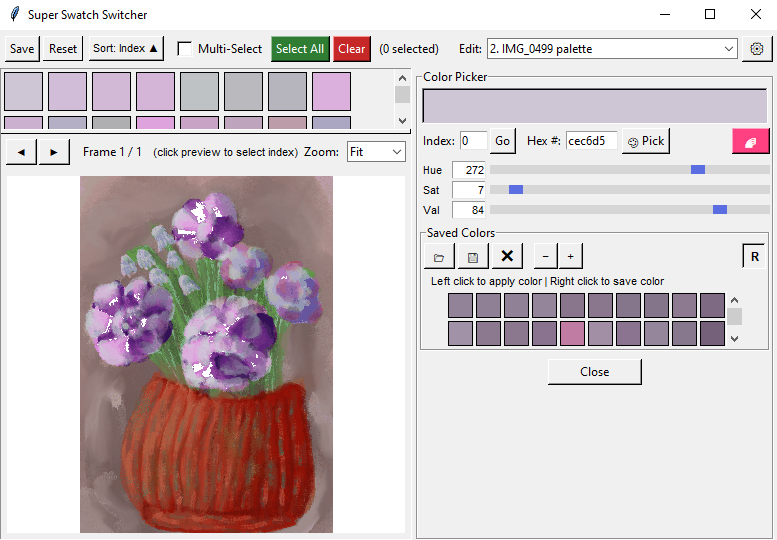
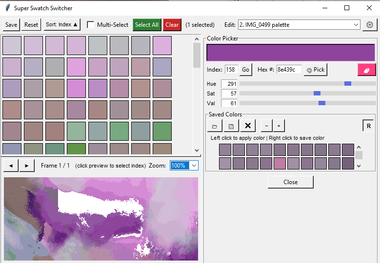
	- NuAge:
		- Image Preview (based on your main UI's Preview Mode), Filtered Indexes, Gradient Button, 
			colorpicker, HSV Sliders, Saved Colors, Click-to-select-index, palette export and
			selection, frame selection, and zoom.
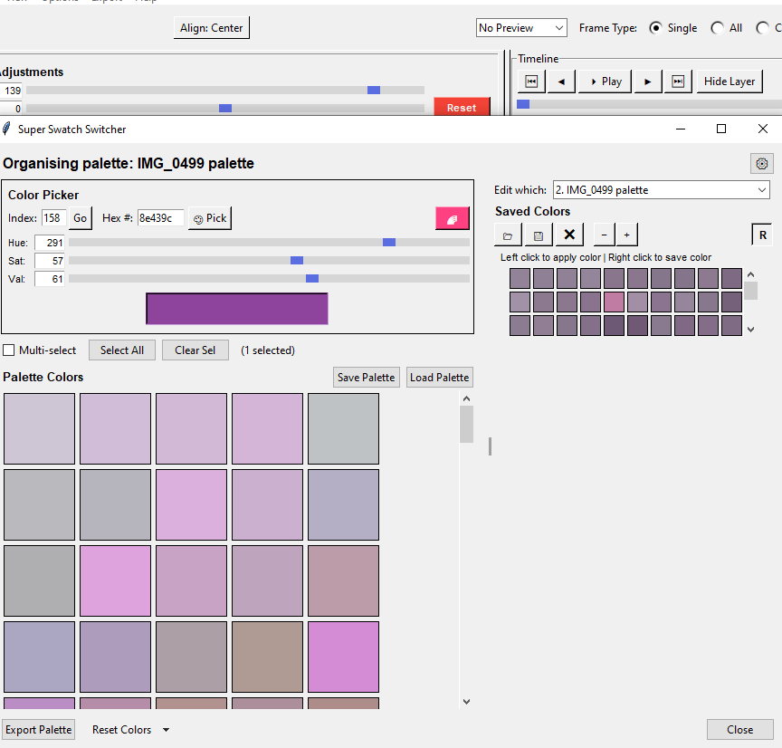
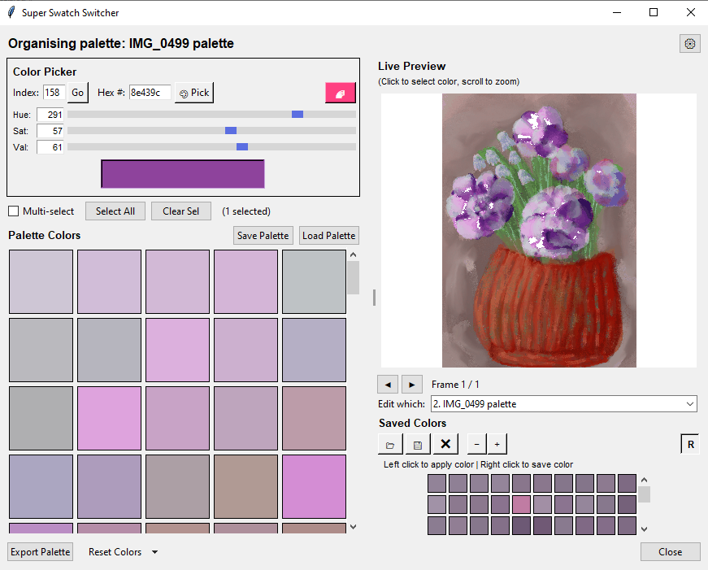
- Timeline, Frame, and Animation Control
- Custom Frame Preview Options (Number of Frames, Start and End Frame)
- Ability to switch between using either a palette, image, or both from any layer
- Right Click Context Menu for Image Preview and Layers Box
	- Image Preview:
		- Set As Current Frame
		- Switch to Single Preview (Switches to `Frame Type: Single`)
		- Select Frame
		- Reverse this frame's palette
		- Hide this frame
		- Hide selected frames
	- Layers Box:
		- Layer >
			- Import Img as Layer
			- Draw [a] Layer
			- New Palette Layer
		- Show > 
			- All Layers
			- Palette Layers
			- Img Layers
		- Palette > 
			- Import Palette...
			- New Palette Layer
- Stack Palettes and change Layer Opacity and Blend Modes
- A mini Manual
- Changelog, including the base program's it was made from that I had created and formerly released
- Frame, Background, and Palette Export
- Awesome Gradient button and Dark Mode
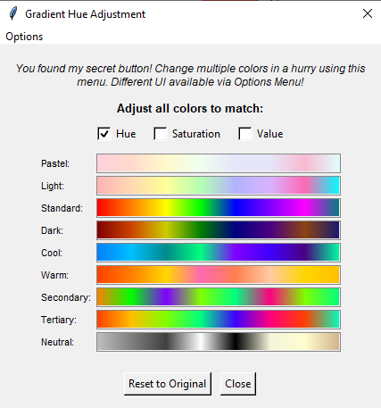

- A sprite editor that supports multiple tools, layers, animations, shortcuts, histograms (Options > Other Options),
	and so much more.
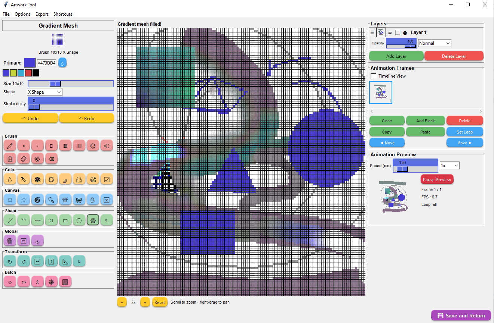
- An image-to-image palette swapper
- A palette to palette swapper for many frames
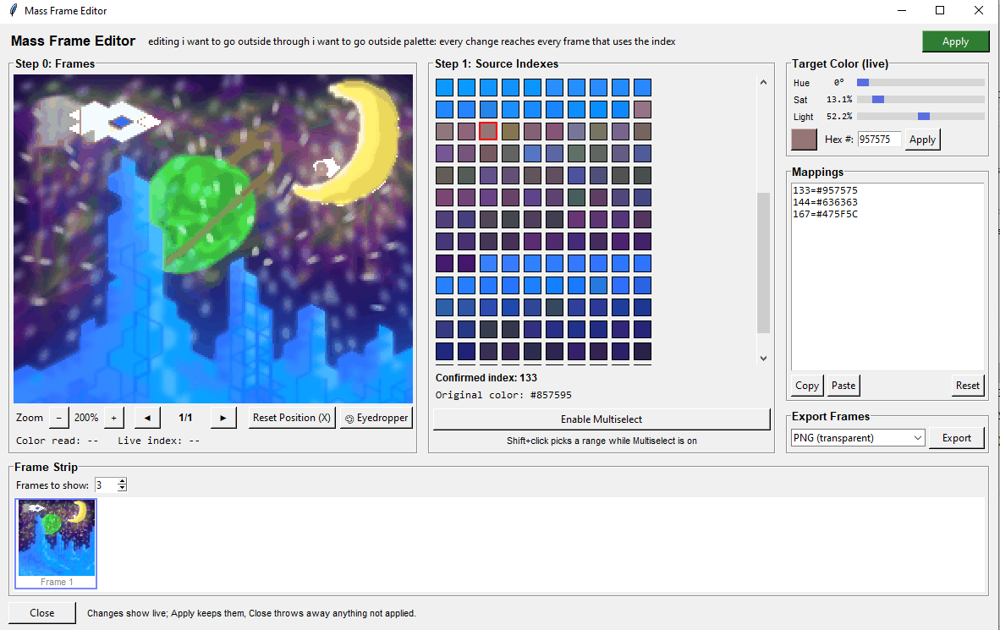
- Local Statistics (For fun :3c )

# Credits

Proprietary software ownership of Mewsie and usage of other Open Source materials along with help from Claude Workspace.

Inspiration originally from having limitations of the software known as [PalEdit](https://www.baker76.com/paledit/).